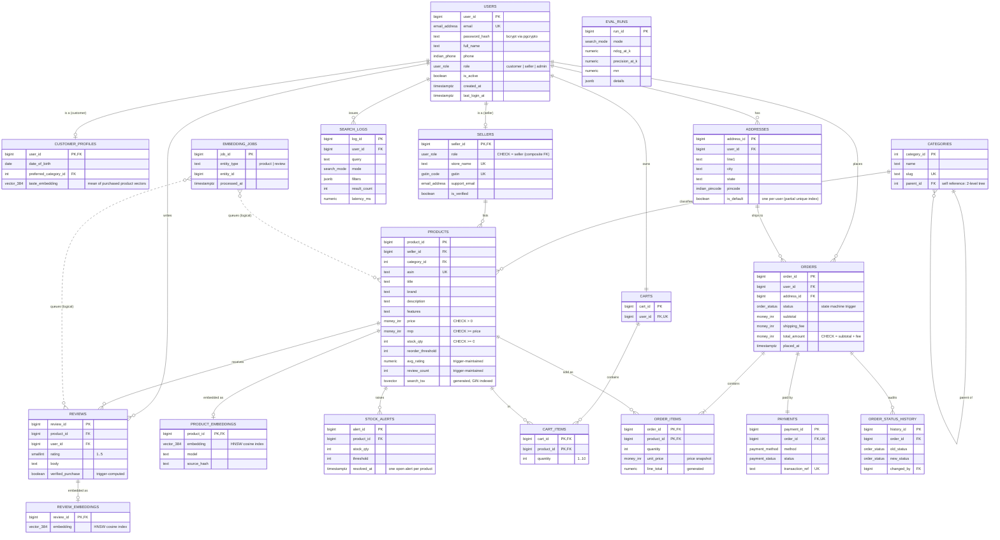

# ER Diagram and Relational Schema

## Entity-Relationship diagram



### Cardinality notes

| Relationship | Cardinality | Implementation |
|---|---|---|
| User → Customer profile / Seller | 1 : 0..1 each (role specialisation, disjoint) | `customer_profiles.user_id` PK+FK; `sellers (seller_id, role)` composite FK to `users (user_id, role)` with `CHECK (role = 'seller')`, so a seller row can only exist for a user whose role is `seller` |
| Category → Category | 1 : N (self-referencing tree) | `categories.parent_id`; traversed with recursive CTEs |
| Seller → Product | 1 : N | `products.seller_id` (ON DELETE RESTRICT) |
| Product → Embedding | 1 : 0..1 | separate table, so the model/version can change without touching the catalog |
| Cart ↔ Product | M : N | associative entity `cart_items` with composite PK |
| Order ↔ Product | M : N | associative entity `order_items` with composite PK (carries `quantity`, `unit_price`) |
| Order → Payment | 1 : 1 | `payments.order_id` UNIQUE |

## Relational schema (3NF)

Underlined = primary key, *italic* = foreign key.

```
users(user_id, email, password_hash, full_name, phone, role, is_active, created_at, last_login_at)
    UNIQUE(email), UNIQUE(user_id, role)

customer_profiles(user_id→users, date_of_birth, preferred_category_id→categories, taste_embedding, taste_updated_at)

sellers(seller_id, role, store_name, gstin, support_email, is_verified, joined_at)
    FK (seller_id, role) → users(user_id, role),  CHECK (role = 'seller')

addresses(address_id, user_id→users, label, line1, line2, city, state, pincode, is_default)

categories(category_id, name, slug, parent_id→categories)

products(product_id, seller_id→sellers, category_id→categories, asin, title, brand, description, features,
         price, mrp, stock_qty, reorder_threshold, image_url, avg_rating, review_count, is_active,
         created_at, updated_at, search_tsv)

product_embeddings(product_id→products, embedding, model, source_hash, embedded_at)

reviews(review_id, product_id→products, user_id→users, rating, title, body, verified_purchase,
        helpful_votes, created_at)
    UNIQUE(product_id, user_id)

review_embeddings(review_id→reviews, embedding, model, source_hash, embedded_at)

embedding_jobs(job_id, entity_type, entity_id, enqueued_at, started_at, processed_at, attempts, last_error)

carts(cart_id, user_id→users)                       UNIQUE(user_id)
cart_items(cart_id→carts, product_id→products, quantity, added_at)           PK(cart_id, product_id)

orders(order_id, user_id→users, address_id→addresses, status, subtotal, shipping_fee, total_amount,
       placed_at, updated_at)
order_items(order_id→orders, product_id→products, quantity, unit_price, line_total)   PK(order_id, product_id)
payments(payment_id, order_id→orders, method, amount, status, transaction_ref, created_at)   UNIQUE(order_id)
order_status_history(history_id, order_id→orders, old_status, new_status, changed_by→users, changed_at)

stock_alerts(alert_id, product_id→products, stock_qty, threshold, created_at, resolved_at)
search_logs(log_id, user_id→users, query, mode, filters, result_count, latency_ms, created_at)
eval_runs(run_id, mode, model, k, query_count, precision_at_k, recall_at_k, mrr, ndcg_at_k,
          avg_latency_ms, details, run_at)
```

### Normalisation argument

* **1NF**: every column is atomic. The only multi-valued attribute, product feature bullets, is stored as
  newline-separated text because it is only ever read and embedded as a unit, never queried per bullet.
* **2NF**: in the two tables with composite keys (`cart_items`, `order_items`), every non-key attribute depends on
  the whole key. `unit_price` depends on (order, product): it is a historical snapshot, deliberately *not* a copy of
  `products.price`.
* **3NF**: no transitive dependencies. Seller details live in `sellers`, category names in `categories`, delivery
  address in `addresses` (orders reference it, they do not copy it).
* **Deliberate, controlled denormalisation** (documented trade-offs, each kept consistent by the database itself):
  * `products.avg_rating`, `products.review_count`: recomputed by statement-level triggers with transition tables;
  * `order_items.line_total`, `products.search_tsv`: `GENERATED ALWAYS … STORED` columns;
  * `orders.subtotal / total_amount`: guarded by `CHECK (total_amount = subtotal + shipping_fee)`;
  * `customer_profiles.taste_embedding`: derived cache of purchase history, refreshed by `refresh_taste_profile()`.
