# ShopSense: Hybrid Semantic Product Discovery Engine with Association-Rule Recommendations

**DBMS Experiential Learning, Level 3 Project Report**
Database option 2: **SQL + Vector database** (PostgreSQL 17 with pgvector) · Web interface: **Next.js**

| | |
|---|---|
| Team | Member A (transactions, integrity, security & analytics) · Member B (search, vectors & recommendations) |
| Stack | PostgreSQL 17.11 · pgvector 0.8.7 · Next.js 15 (App Router) · TypeScript · transformers.js (all-MiniLM-L6-v2) |
| Repository | _public GitHub link to be added by the team_ |

---

# 1. Objectives

Online search is usually *lexical*: it returns products whose text contains the typed words. It fails when shoppers
describe a **need** rather than a product name ("something to keep my dog's teeth clean"), and pure semantic search
fails in the opposite direction on exact identifiers. The project builds a marketplace whose database layer solves both:

1. **Hybrid retrieval** that fuses PostgreSQL full-text ranking with vector similarity over product descriptions and
   customer reviews, in a single SQL function, with relational filters (price, category, rating, stock).
2. **Measured search quality**: lexical, semantic and hybrid retrieval compared on labelled queries, including a
   held-out set, rather than claimed.
3. **Database-enforced integrity and security**: constraints and domains, triggers, atomic and concurrency-safe
   transactions, role-based access enforced by Row-Level Security.
4. **Analytics** for sellers and administrators: revenue trends, association rules ("frequently bought together"),
   inventory alerts.

# 2. Functional requirements

| ID | Requirement | Role |
|---|---|---|
| F1 | Register / sign in; passwords hashed in the database; sessions as signed cookies | all |
| F2 | Search products in natural language; modes keyword / semantic / hybrid; filters (category, price, rating, stock); explanation of why a product matched; side-by-side comparison of the three modes | all |
| F3 | Typo-tolerant title suggestions | all |
| F4 | Product page: details, rating distribution, reviews (verified-purchase badge), similar products, frequently-bought-together | all |
| F5 | Cart, atomic checkout with address and simulated payment, order history, cancellation with stock restoration | customer |
| F6 | Write a review (verified status computed by the database) | customer |
| F7 | Personalised recommendations from purchase history | customer |
| F8 | Manage own products: create, edit, price, stock, thresholds; restock; see embedding status | seller |
| F9 | Seller dashboard: revenue trend, month-over-month growth, moving averages, top products with ranks, low-stock alerts, orders to fulfil with status progression | seller |
| F10 | Platform dashboard: revenue, category roll-up, seller leaderboard, search analytics, zero-result queries, embedding queue | admin |
| F11 | User management (activate/deactivate) | admin |
| F12 | Search-quality benchmark results; concurrency lab; `EXPLAIN ANALYZE` viewer | admin |

Non-functional: no credentials in source (environment variables), input validation at the database level, least
privilege database role, reproducible seed data.

# 3. System architecture

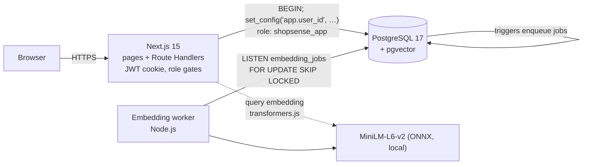

* **Next.js** serves pages (server components query the database directly through a data layer) and JSON route
  handlers. Every database interaction runs inside a transaction that first sets `app.user_id`. Row-Level Security
  policies use it, so the *same SQL* returns different rows for different users.
* **Role separation.** The web app connects as `shopsense_app` (no superuser, no `BYPASSRLS`, column-level grants; it
  cannot read `password_hash`). Setup scripts and the embedding worker use a separate owner role.
* **Embedding worker** drains a trigger-filled queue, so a seller editing a product description makes it
  semantically searchable again within seconds, without any application code remembering to do so.

# 4. Database choice and justification

| Data | Technology | Justification |
|---|---|---|
| Users, sellers, catalog, prices, stock, carts, orders, payments, audit | **PostgreSQL (relational)** | Structured, strongly related data; needs ACID transactions (checkout must never oversell), foreign keys, constraints, joins and aggregate analytics. |
| Product and review text as 384-d embeddings | **pgvector** | Unstructured natural language that must be matched by meaning. Co-locating vectors with the catalog lets one query combine similarity with price/stock/rating filters and keeps vectors transactionally consistent with their rows. HNSW gives sub-10 ms search at 85k vectors (§9.3). |
| Product text as `tsvector` | **PostgreSQL full-text (GIN)** | Exact terms, brands and model numbers are better matched lexically; also the baseline the vector search is compared against. |

A separate NoSQL store was deliberately **not** added: no part of the data is schema-less or graph-shaped enough to
justify a second system to keep consistent. The one semi-structured field (`search_logs.filters`, `eval_runs.details`)
uses PostgreSQL `jsonb`.

# 5. ER diagram and relational schema

{{ER_DIAGRAM}}

# 6. Database implementation

Source: `db/01…07_*.sql`, applied in order by `npm run db:setup`.

## 6.1 DDL: tables, constraints, domains, indexes

* **19 tables**, 5 enumerated types, 5 validation **domains** (`email_address`, `money_inr`, `indian_pincode`,
  `indian_phone`, `gstin_code`) so the same rule applies everywhere a value is stored.
* **Keys:** surrogate identity primary keys, composite primary keys on the two associative tables (`cart_items`,
  `order_items`), `UNIQUE` on natural keys (email, store name, GSTIN, ASIN, one review per user per product).
* **Referential actions chosen deliberately:** `RESTRICT` where history must be preserved (orders → users,
  order items → products), `CASCADE` for owned data (cart items, embeddings), `SET NULL` where a record should survive
  its author (reviews).
* **Integrity beyond column checks:** `CHECK (mrp >= price)`, `CHECK (total_amount = subtotal + shipping_fee)`, a
  **composite foreign key** `sellers(seller_id, role) → users(user_id, role)` with `CHECK (role='seller')` so a seller
  row can only belong to a user whose role is seller, **partial unique indexes** (one default address per user, one
  open stock alert per product, one pending embedding job per entity), and generated columns (`line_total`,
  `search_tsv`).
* **Indexes:** B-tree (foreign keys, composite `(user_id, placed_at DESC)`), partial, **GIN** on the weighted
  `tsvector` and a trigram index, **HNSW** (`vector_cosine_ops`) on both embedding tables.
* **DDL evolution** (`ALTER`, `DROP`): `db/demo/ddl_demo.sql` walks through every DDL form on a scratch table;
  `npm run db:setup -- --reset` drops and rebuilds the schema.

## 6.2 Advanced features implemented

| Concept | Where |
|---|---|
| **Transactions & locking** | `checkout()`: atomic, `SELECT … FOR UPDATE` in primary-key order (deadlock-free); `cancel_order()` |
| **Stored functions / procedures** | 32 routines, e.g. `checkout`, `cancel_order`, `search_products`, `register_*`, `authenticate`, `recommend_for_me`, `restock_product` (PROCEDURE), `refresh_analytics` (PROCEDURE) |
| **Triggers** (15) | low-stock alerts (+`NOTIFY`); embedding queue (de-duplicated); verified-purchase flag; rating aggregates (**statement-level with transition tables**); order **state-machine** guard; status audit trail; cart stock validation; email normalisation; `updated_at` |
| **Views / materialized views** | 5 views (`v_product_cards`, `v_public_reviews`, `v_sales_lines`, `v_low_stock`, `v_category_tree`) and 2 materialized views refreshed `CONCURRENTLY` (`mv_daily_sales`, `mv_product_pairs`) |
| **Indexing** | B-tree, partial, GIN (FTS + trigram), HNSW |
| **Full-text search** | weighted `tsvector` (title A, brand B, features C, description D) + `ts_rank_cd` |
| **Vector similarity search** | cosine KNN, hybrid RRF, similar products, personalised recommendations |
| **Window functions & ROLLUP** | `LAG`, moving averages, `RANK() OVER (PARTITION BY …)`, `GROUP BY ROLLUP` |
| **Recursive CTE** | category tree / breadcrumbs |
| **Row-Level Security** | 13 tables, per-role policies |
| **Security** | `pgcrypto` bcrypt, `SECURITY DEFINER` with pinned `search_path`, column-level `GRANT`, least-privilege role |

## 6.3 Triggers in detail

| Trigger | Event | Behaviour |
|---|---|---|
| `trg_products_stock_alert` | AFTER INSERT/UPDATE of stock, threshold | opens/updates an alert when `stock_qty < reorder_threshold`, resolves it on restock; `pg_notify` |
| `trg_*_enqueue_embedding_*` | AFTER INSERT / UPDATE of embedded text | inserts one pending job (`ON CONFLICT DO NOTHING`), notifies worker; price/stock edits do **not** enqueue |
| `trg_reviews_verify` | BEFORE INSERT on reviews | sets `verified_purchase` from order history; ignores any client-supplied value |
| `trg_reviews_stats_*` | AFTER INSERT/UPDATE/DELETE, **FOR EACH STATEMENT** with transition tables | recomputes `avg_rating`/`review_count` once per affected product per statement |
| `trg_orders_status_guard` | BEFORE UPDATE of status | allows only pending→paid/cancelled, paid→shipped/cancelled, shipped→delivered; else `SS004` |
| `trg_orders_status_history` | AFTER INSERT/UPDATE of status | audit row with actor |
| `trg_cart_items_validate` | BEFORE INSERT/UPDATE | rejects quantity above stock or inactive products |

Trigger functions that write to tables the application role cannot touch are `SECURITY DEFINER`. This was found
and fixed through the test suite (§11): with invoker rights, restocking a product failed with *permission denied*.

## 6.4 Authentication and authorisation

* Registration and login are database functions (`register_customer`, `register_seller`, `authenticate`) that hash
  with bcrypt (`crypt(…, gen_salt('bf'))`). The application never sees a hash.
* Three roles: **customer, seller, admin**. Enforced at three layers: Next.js middleware (friendly redirect), route
  handlers (`requireRole`), and **Row-Level Security** (the authority).
* **RLS in practice:** one SQL statement `SELECT … FROM v_sales_lines` returns a seller's own lines for a seller, only
  a customer's own orders for a customer, everything for an admin, nothing for an anonymous visitor. Sellers see only
  *their* lines even inside a shared order. The seller dashboard queries contain no `WHERE seller_id = …`.

# 7. Vector database design

_(Full design: `docs/vector-database-design.md`.)_

| Question (rubric §8) | Answer |
|---|---|
| What is converted to embeddings? | Product text (title, brand, category path, feature bullets, description) and review text (title + body) |
| Which model? | `all-MiniLM-L6-v2` (22M parameters), 384-d, mean-pooled and L2-normalised, run locally with transformers.js (ONNX, CPU); input capped at the model's 256-token training length |
| How are vectors stored? | `vector(384)` columns in `product_embeddings` and `review_embeddings` (separate from the catalog), plus `customer_profiles.taste_embedding` (mean vector of purchased products). Each row stores the model name and an md5 of the source text |
| Similarity metric? | Cosine distance (`<=>`), HNSW index `(m=16, ef_construction=64)`, `ef_search=200`, `iterative_scan` for filtered queries |
| How is relevance retrieved? | **Hybrid Reciprocal Rank Fusion** of three ranked lists (keyword, product vectors, best-matching review vector), filtered by relational predicates |

## 7.1 Hybrid retrieval

```
score(p) = w_lex/(60 + rank_lexical) + 1/(60 + rank_semantic) + 0.5/(60 + rank_review)
w_lex    = 1.0 if some eligible product contains ALL query terms (rank only those)
         = 0.25 otherwise (OR-fallback; a partial keyword match is weak evidence)
```

## 7.2 Embedding consistency

Triggers enqueue a job whenever embedded text changes; a worker using `LISTEN/NOTIFY` and
`FOR UPDATE SKIP LOCKED` embeds in batches and skips unchanged text. A re-embedding of 17,117 items took about 31
minutes on a laptop CPU; a single edit becomes searchable in seconds.

# 8. Important queries

See `docs/important-queries.md` for the annotated SQL. Highlights: hybrid RRF search (Q1); association rules with
support, confidence and lift (Q2); month-over-month growth and moving averages (Q3, Q4); `ROLLUP` (Q5); rank within
category (Q6, Q7); atomic checkout (Q8); low-stock trigger (Q9); vector recommendations with `LATERAL` (Q10, Q11);
recursive CTE (Q12); trigram suggestions (Q13).

# 9. Results

## 9.1 Search quality

**Method.** Two labelled query sets: `eval/queries.json` (40 queries: 28 natural-language, 12 exact) and
`eval/holdout.json` (18 queries, written *before* the fusion algorithm was revised and never used to tune it).
A product is relevant if it lies in the query's category and its text matches a concept pattern; grade 2 if the
concept is in the title, 1 if elsewhere. Metrics at k = 10; nDCG uses the graded labels. Labels are computed in SQL
and are independent of the retrieval code. Natural-language queries deliberately use different words from the labels.

**Result: main set (40 queries), final algorithm**

| Mode | nDCG@10 | P@10 | Recall@10 | MRR | nDCG natural-language | nDCG exact |
|---|---|---|---|---|---|---|
| Keyword (full-text) | 0.492 | 0.472 | 0.472 | 0.813 | 0.338 | 0.852 |
| Semantic (vectors) | 0.660 | 0.677 | 0.677 | 0.855 | 0.575 | 0.857 |
| **Hybrid (RRF)** | **0.687** | **0.710** | **0.710** | **0.880** | **0.600** | **0.890** |

**Result: held-out set (18 queries), final algorithm**

| Mode | nDCG@10 | P@10 | MRR | nDCG natural-language | nDCG exact |
|---|---|---|---|---|---|
| Keyword | 0.402 | 0.372 | 0.715 | 0.272 | 0.664 |
| Semantic | 0.733 | 0.733 | 0.889 | 0.714 | 0.771 |
| **Hybrid** | **0.738** | **0.744** | 0.861 | **0.720** | 0.773 |

**What this shows, and what it does not.**

* Vector search is the large win: nDCG 0.49 → 0.66 (main) and 0.40 → 0.73 (held-out) over keyword search, and it
  is what makes natural-language queries work (nDCG 0.34 → 0.58).
* **The first hybrid design was wrong, and we found out by measuring.** With equal-weight RRF, hybrid scored 0.649
  (main) and 0.589 (held-out): *worse than semantic alone* (0.660 / 0.733). The per-query table showed why: for
  intent-style queries the OR-keyword list returned junk (matching words like "night" or "make"), and RRF gave
  it as much influence as the good semantic list. For *"make my backyard glow at night without wiring"*, hybrid scored
  0.10 against 0.49 for semantic.
* **The fix** (conjunctive keyword match when one exists; otherwise OR at weight 0.25) lifted hybrid to 0.687 / 0.738.
  The weight 0.25 is a round constant chosen before looking at results; it was *not* fitted to the labels.
  Because it improved the **held-out** set too, the gain is not just overfitting to the 40 queries we had inspected.
* **Caveats.** Hybrid's lead over semantic is clear on the main set (+0.027 nDCG, +0.033 P@10) but within noise on
  the 18-query held-out set (+0.005), and semantic has a slightly higher MRR there. We therefore claim *hybrid is at
  least as good as semantic and far better than keyword*, with the clearest benefit on exact queries (0.890 vs
  0.857), not that hybrid dominates. Labels are pattern-based approximations of human judgement, and the catalog is
  3,000 products, so absolute values are not comparable with other benchmarks.
* Before the revision the same runs are stored in `eval_runs` as variant `rrf-equal-weights`; the final ones as
  `rrf-adaptive`.

## 9.2 Application behaviour

Association rules: 3,840 product pairs; "frequently bought together" shown where lift > 1. Seed data contains planted
co-purchase structure and seasonality (festive peaks), so trends and rules are meaningful but **synthetic**.

## 9.3 Index performance (`npm run bench`, `EXPLAIN ANALYZE`)

{{BENCHMARKS}}

**Reading the vector table honestly.** At 3k–14k vectors an exact scan already takes only 3–18 ms, so HNSW is not
meaningfully faster there, and differences of a few milliseconds are within run-to-run noise (random probes, small
medians). The index pays off at scale: with 85,585 vectors an exact scan costs about 80–90 ms against 4–10 ms for
HNSW at recall 0.95–1.00. The GIN index gives 30–110× over a sequential scan and the composite B-tree 24×. The
materialized view is 3.7× faster than the live aggregate, at the price of staleness until refreshed.

## 9.4 Concurrency lab

Two buyers race for the last unit (T2 starts 300 ms after T1). **Naive read-then-write** (no lock): both read
stock = 1, both sell, stock ends at 0 with **2 units sold**: a lost-update anomaly. **`checkout()`** (row lock):
T2 blocks until T1 commits, then reads stock = 0 and fails with `SS001`: **1 unit sold**. Reproduce with
`npm run race` or at `/admin/lab`. The automated test `concurrency: two buyers racing for the last unit` asserts the
outcome.

# 10. Application screenshots

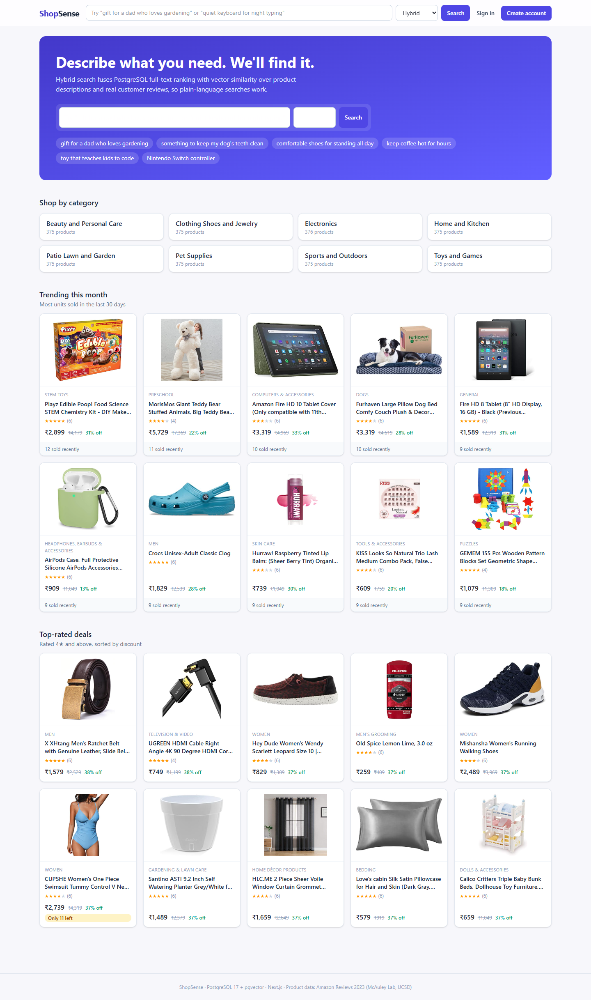
*Home: natural-language search box, example queries, categories, trending products.*

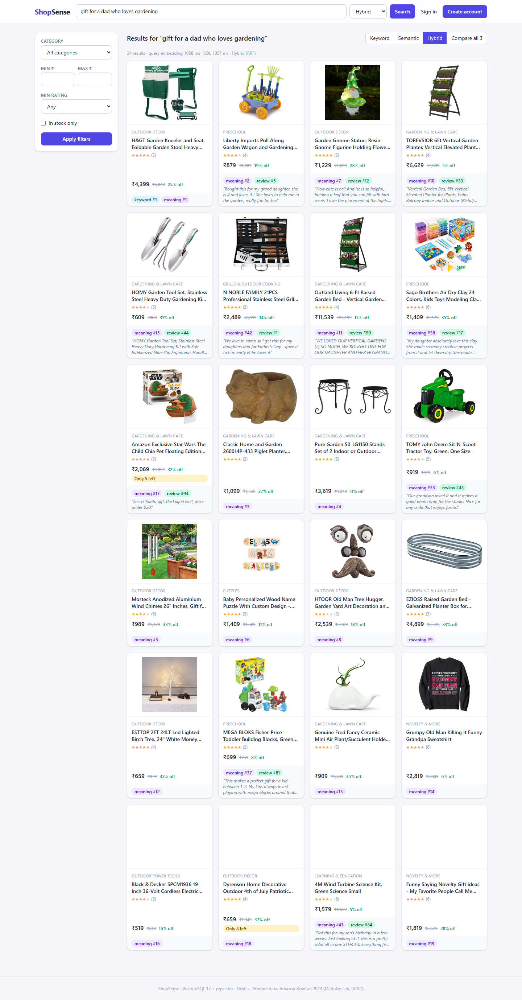
*Hybrid search for "gift for a dad who loves gardening", with per-list ranks and the matching customer-review sentence.*

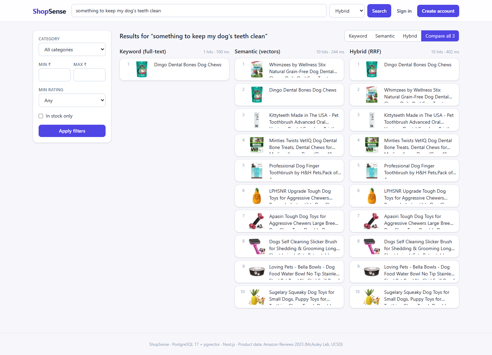
*"Compare all 3": keyword, semantic and hybrid results side by side.*

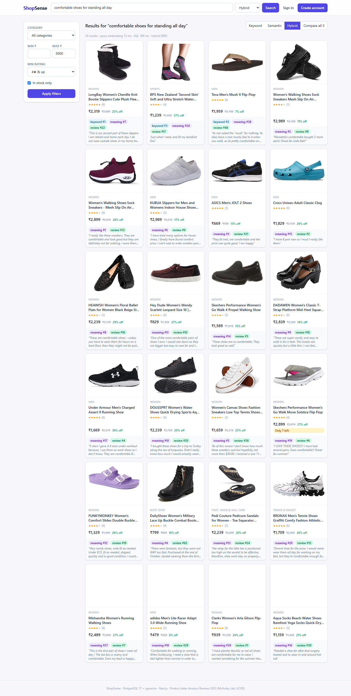
*Relational filters (price, rating, in stock) applied inside the same SQL function.*

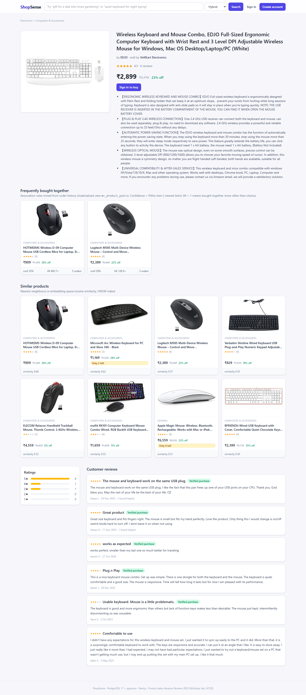
*Product page: ratings, reviews, similar products (vector KNN), frequently bought together (association rules).*

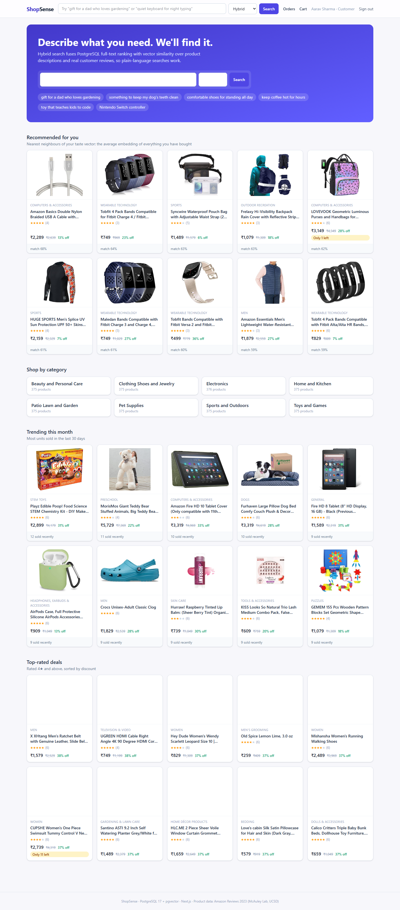
*Signed-in customer: recommendations from the taste vector.*

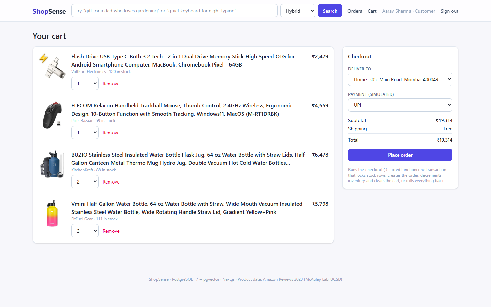
*Cart and checkout (one atomic stored function).*

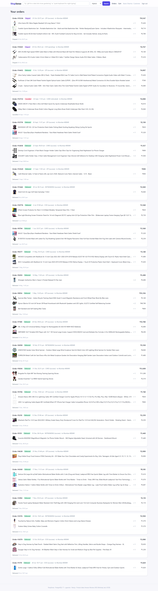
*Order history with status timeline from the audit trigger.*

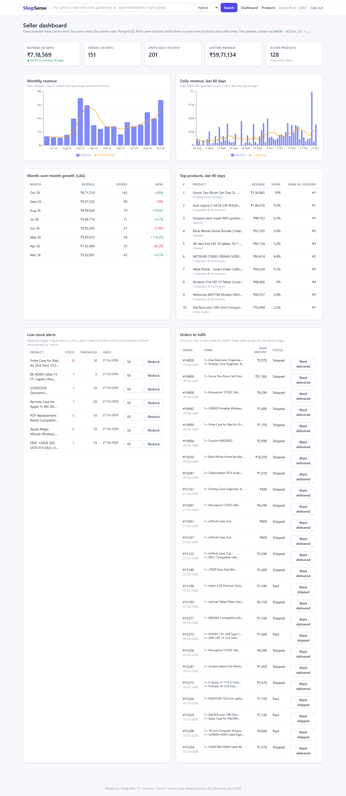
*Seller dashboard (all numbers restricted by RLS): revenue trend, LAG growth, ranks, low-stock alerts, fulfilment.*

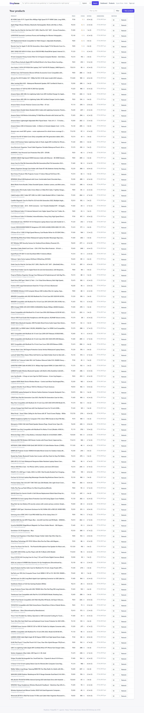
*Seller product management with embedding status.*

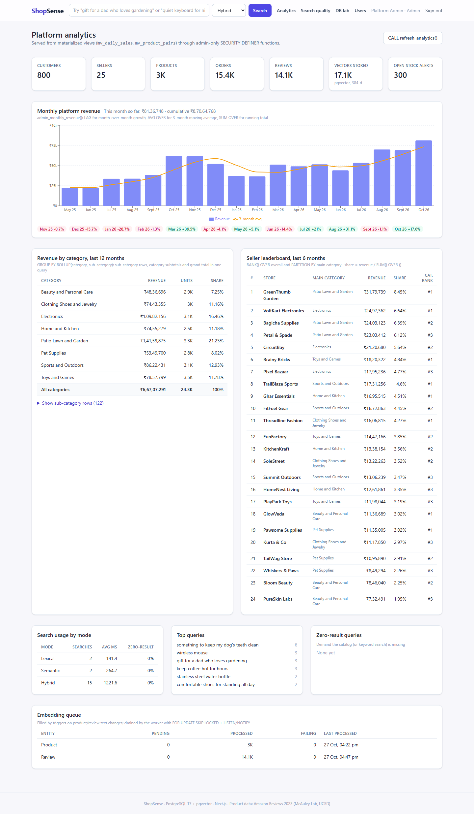
*Admin analytics: ROLLUP, seller leaderboard, search analytics, embedding queue.*

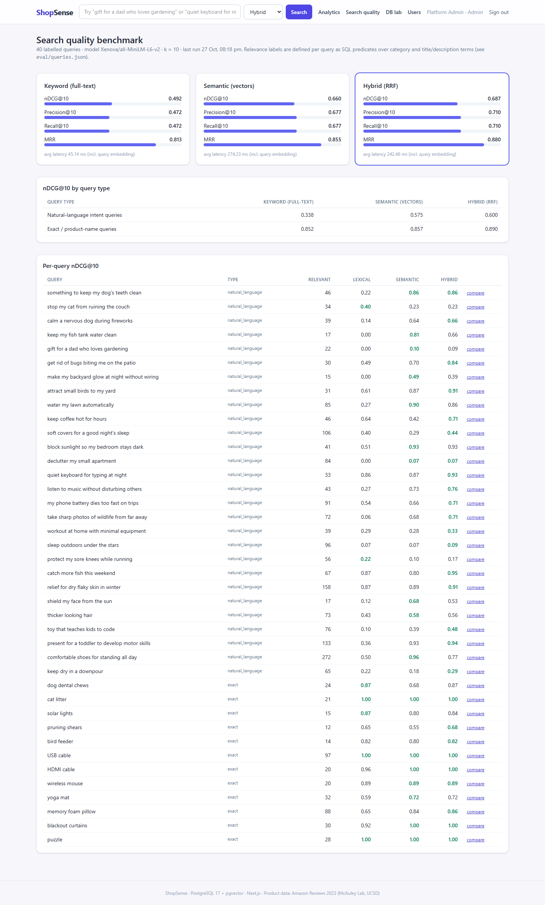
*Search-quality benchmark results.*

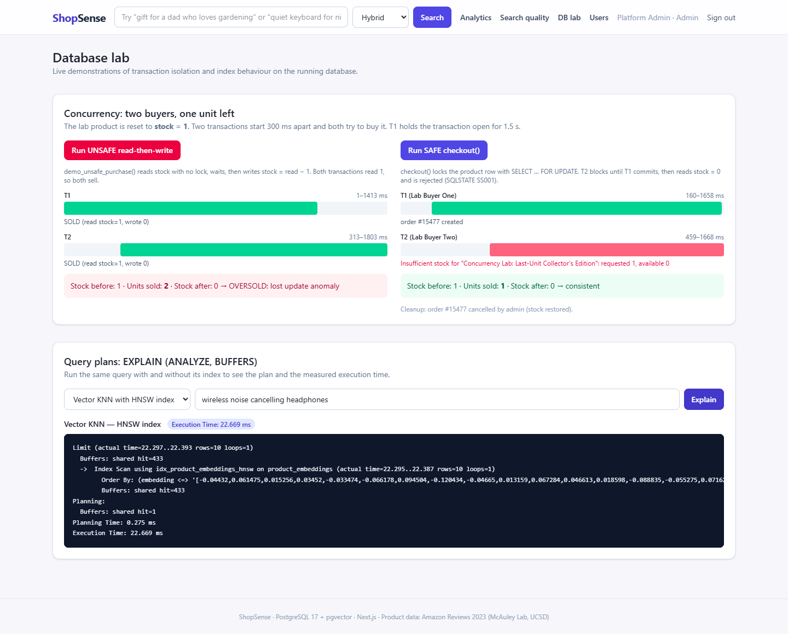
*Concurrency lab and EXPLAIN ANALYZE viewer.*

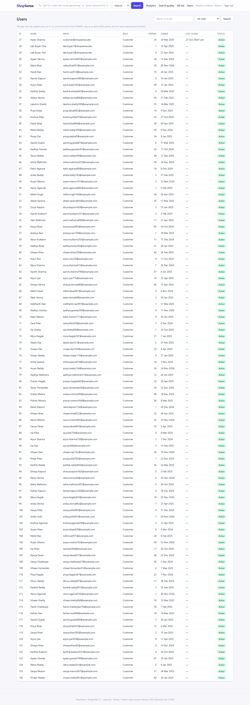
*Admin user management.*

# 11. Testing

`npm test` runs 22 integration tests against the live database. They connect as the **least-privilege application
role**, exactly as the web app does, create their own fixtures and remove them afterwards (the suite was run
repeatedly and leaves no data behind).

| # | Test | Verifies |
|---|---|---|
| 1 | authenticate | right/wrong password, unknown user, case-insensitive email |
| 2 | password storage | bcrypt format; app role cannot `SELECT password_hash` (column grant) |
| 3 | register validation | weak password `SS005`; duplicate email |
| 4 | domains & CHECKs | bad email, phone, PIN, GSTIN, price ≤ 0, MRP < price, negative stock, rating 6, short review |
| 5 | composite FK | a non-seller user cannot become a seller |
| 6 | checkout | order, price snapshot, free shipping ≥ ₹499, stock decremented, cart cleared, payment, audit row |
| 7 | checkout failures | empty cart `SS002`; over-stock `SS001` via trigger and via stale cart; no partial order left |
| 8 | address ownership | cannot ship to someone else's address |
| 9 | **concurrency** | two parallel checkouts of the last unit → exactly one succeeds, final stock 0 |
| 10, 11 | cancel | owner only; stock restored; payment refunded; double-cancel rejected `SS004` |
| 12 | order state machine | illegal transitions rejected; history recorded |
| 13 | low-stock trigger | alert opens below threshold, updates in place, resolves on restock via procedure |
| 14 | RLS (write) | seller cannot update/restock/insert for another seller |
| 15 | RLS (read) | customer, both sellers, anonymous see exactly the rows they should; same view gives different revenue |
| 16 | RLS (users) | only own row visible; cannot change role; admin-only function rejected |
| 17 | review triggers | client-supplied `verified_purchase` overridden; duplicate review; impersonation; aggregates correct |
| 18 | embedding queue | text edit enqueues exactly one job; price edit enqueues none |
| 19 | association rules | pairs with lift > 1; probabilities within [0, 1] |
| 20 | lexical search | finds fixture by rare term; price filter respected |
| 21 | hybrid search | ordered by fused score; a product's own vector retrieves it with similarity ≈ 1 |
| 22 | category helpers | recursive descendants; breadcrumb |

**Result: 22 passed, 0 failed.**

**Bugs the tests and the benchmarks caught** (all fixed):

1. Trigger functions ran with the caller's rights, so a seller restocking a product (or a customer posting a
   review) failed with *permission denied* on `stock_alerts`/`embedding_jobs`. Fixed with `SECURITY DEFINER`
   triggers.
2. The generic embedding-queue trigger read a column that does not exist on one of the two tables.
3. Hybrid fusion weighted noisy keyword matches equally with semantic ones (§9.1).
4. The first fix for (3) made keyword queries ~3× slower, because the planner evaluated the match row by row
   instead of using the GIN index; restructured with materialized match CTEs (≈100 ms → ≈25 ms).
5. Two test-design errors (an over-strict assumption that a product is its own unique nearest neighbour in a catalog
   with near-duplicates; reused fixtures making a "not verified" case legitimately verified).

HTTP-level checks (login for each role, role-gated routes, validation messages originating from database
constraints) were exercised against the running server.

# 12. Individual contributions

| Member A: transactions, integrity, security & analytics | Member B: search, vectors & recommendations |
|---|---|
| ER diagram, schema, domains, constraints, indexes | Dataset ingestion; embedding pipeline and queue worker |
| `checkout`, `cancel_order`, concurrency lab and test | `search_products` (FTS + vector + RRF), search UI, comparison view |
| Triggers: stock alerts, verified purchase, ratings, state machine, audit | Search-quality benchmark, held-out set, fusion revision |
| Authentication, roles, Row-Level Security, validation | Frequently-bought-together, similar products, personalisation |
| Seller and admin dashboards (window functions, ROLLUP) | Product pages, autocomplete, index benchmark, `EXPLAIN` viewer |

_Commit history in the repository records the individual contributions._

# 13. Limitations and future work

* Payments, shipping and tax are simulated. Orders, users and carts are synthetic; only product and review text are
  real (Amazon Reviews 2023, McAuley Lab). Prices are converted from USD at a flat rate; products without a price get
  a plausible one.
* Relevance labels are pattern-based, not human-annotated; the benchmark is small (58 queries) and the hybrid-vs-
  semantic difference on unseen queries is within noise. A human-labelled set, a cross-encoder re-ranker, or
  fine-tuning the embedding model would be the next steps.
* The embedding model is a small general-purpose English model; multilingual queries are out of scope.
* Materialized views are refreshed on demand (`CALL refresh_analytics()`); a scheduled refresh (`pg_cron`) would
  remove staleness.

# 14. Conclusion

The project shows a clear connection between database concepts and a working application: the vector database
is justified by unstructured product and review text, co-located with relational data so one query combines
semantic similarity with business filters; integrity, concurrency and access control are enforced by the database
itself (constraints, triggers, row locks, Row-Level Security) rather than by application code; and the claims about
search quality are backed by measurement, including a failure we found, diagnosed and fixed, and a held-out set to
check the fix. Vector search lifted nDCG@10 from about 0.4–0.5 to 0.66–0.74 over keyword search, and the corrected
hybrid design matches or exceeds semantic search while keeping exact-match behaviour.

---

# Appendix A: Data dictionary

{{DATA_DICTIONARY}}

# Appendix B: Views, functions, procedures and triggers

{{SCHEMA_REFERENCE}}
