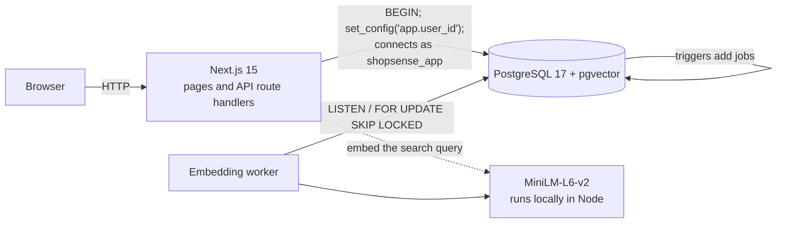
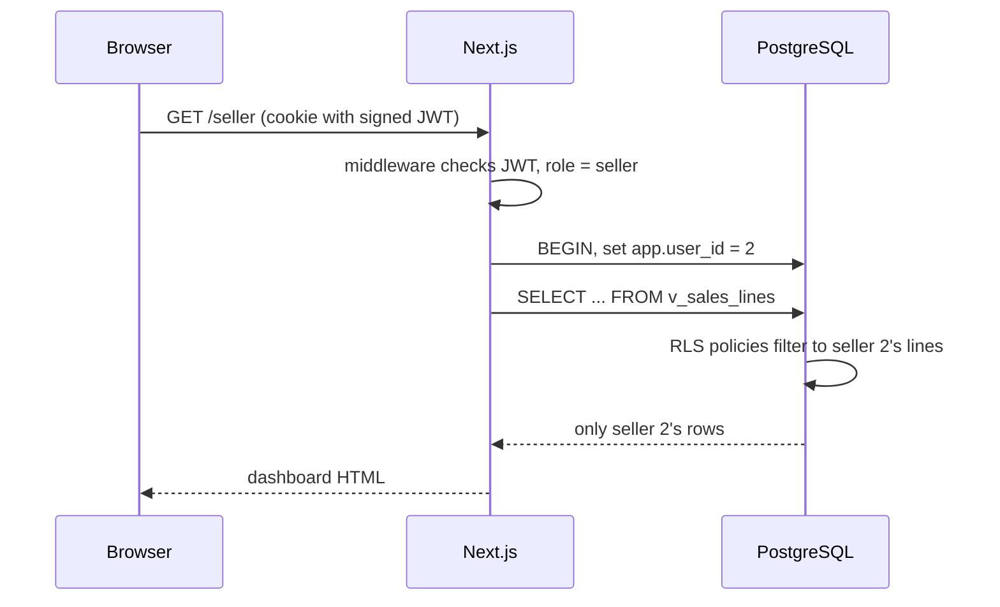

{{COVER:Viva Guide|Everything the team needs to explain ShopSense: concepts, architecture, walkthroughs and likely questions|DBMS Level 3 Project · Preparation notes for Akshat and teammate}}

# How to use this guide

This is written for the two of you to read before the viva. It explains the project in plain language first, then each
database concept (what it is, why we used it, where it is in the code), then walks through what happens when someone
uses the app, and ends with a bank of likely questions with answers.

**Rules of thumb for the viva**

* The examiner is marking *database concepts connected to a working application*. For every feature, be ready to say
  which concept it shows and where the code is.
* Be honest about limits (synthetic orders, small benchmark). The report already says so, and examiners respect
  accuracy more than big claims.
* You will be asked to **modify something live** (the evaluation email mentions "project modifications"). Part 9 has
  ready-made recipes for the common ones.
* Both of you must be able to explain the *whole* system at a high level, and your own half in depth. A suggested
  split is in Part 10; agree on it between you.

**One-minute pitch** (memorise this)

> Normal shop search matches keywords, so "something to keep my dog's teeth clean" finds nothing when the product says
> "dental chews". ShopSense stores the shop in PostgreSQL and also stores each product description and review as a
> 384-number vector in the same database using pgvector. One SQL function combines keyword search and vector similarity
> with a method called Reciprocal Rank Fusion, and applies price, rating and stock filters in the same query. Around that
> we built the database features from the course: constraints, triggers, transactions with row locks so the last unit
> can't be sold twice, views, window-function analytics, and Row-Level Security so a seller can only ever see their own
> data. We measured search quality on 58 labelled queries and found our first fusion design was actually worse than
> semantic-only; we diagnosed why and fixed it.

# Part 1: The project in plain language

## 1.1 The problem

* **Lexical (keyword) search** returns items containing the typed words. It fails on synonyms and on queries that
  describe a need.
* **Semantic (vector) search** compares meaning, so it handles the need-style queries, but it can be fuzzy on exact
  names and numbers ("iPhone 15 case" may return an iPhone 14 case).
* Shops also need trustworthy numbers (what sells together, revenue trends, what is running out) and a database that
  never sells stock it doesn't have.

## 1.2 What we built

A marketplace with three kinds of user:

| Role | What they can do |
|---|---|
| **Customer** | Search (keyword, semantic, hybrid, or all three side by side), view products, add to cart, check out, see and cancel orders, write reviews, get recommendations |
| **Seller** | Manage their own products and stock, see their revenue trends, top products, low-stock alerts, and move orders through shipped and delivered |
| **Admin** | See platform-wide analytics, manage users, see search-quality results, run the concurrency lab and `EXPLAIN` viewer |

## 1.3 Why this satisfies the course requirement

The requirement says to use SQL plus either NoSQL or a vector database, justified by the data. Our justification:

| Data | Where | Why |
|---|---|---|
| Users, products, prices, stock, carts, orders, payments | PostgreSQL tables | Structured and related; needs ACID transactions, foreign keys, constraints, joins |
| Product and review text as meaning | pgvector columns in the same database | Unstructured text that must be matched by meaning; same database means one query can combine similarity with price/stock filters and stays consistent |
| Product text as keywords | PostgreSQL full-text (`tsvector` + GIN) | Exact brands and model numbers are matched best lexically |

We did **not** add MongoDB or Neo4j on purpose: nothing in our data is schema-less or graph-shaped enough to justify a
second system to keep in sync. (If asked: "technology should follow the data, not the other way round.")

# Part 2: Architecture



## 2.1 The pieces

* **Next.js (App Router).** Folders map to URLs. `src/app/search/page.tsx` is `/search`. Pages are *server
  components*: they run on the server and call the database directly through `src/lib/data/*`. Files named `route.ts`
  under `src/app/api` are *route handlers* (the REST-style API) such as `POST /api/checkout`.
* **PostgreSQL 17 + pgvector** in a Docker container (`docker-compose.yml`, port 5433). All business rules live here.
* **Embedding model** (all-MiniLM-L6-v2) runs *inside our Node process* using transformers.js and ONNX. No paid API, no
  data leaves the machine.
* **Embedding worker** (`scripts/embed-worker.mjs`): a separate Node process that turns new or edited text into vectors.
* **Two database roles.** `shopsense_owner` owns the tables and is used only by scripts. The web app connects as
  `shopsense_app`: not a superuser, cannot bypass Row-Level Security, and cannot even read `password_hash`.
  This is the principle of **least privilege**.

## 2.2 How a request reaches the database (the single most important idea)

Every database call in the web app goes through `withUser()` in `src/lib/db.ts`:

```text
BEGIN;
SELECT set_config('app.user_id', '27', true);   -- "true" = only for this transaction
... the actual queries ...
COMMIT;
```

The database's Row-Level Security policies read `app.user_id`, then look up that user's role **in the users table**
(never from the browser), and decide which rows exist for the query. So the *same SQL text* returns different rows for
a customer, a seller and an admin. That is why the seller dashboard queries contain no `WHERE seller_id = …`.



## 2.3 Three layers of access control

1. **Middleware** (`src/middleware.ts`): redirects, e.g. a customer opening `/admin` goes home. This is only for a
   friendly experience.
2. **Route handlers** (`requireRole()` in `src/lib/auth.ts`): return 401 or 403 for the API.
3. **Row-Level Security in the database**: the real authority. Even if layers 1 and 2 had a bug, the database would not
   return rows the user may not see.

> **Viva tip.** If asked "what if someone edits the cookie?", the cookie is a signed JWT (HS256) and cannot be edited.
> And even a stolen valid session can only see that user's rows, because RLS decides. A deactivated user's old token is
> useless too: `app_role()` returns nothing when `is_active` is false, so RLS denies everything.

# Part 3: The database concepts, one by one

Each concept below has: **what it is**, **why we used it**, **where it is in the project**.

## 3.1 ER model, relational schema and normalisation

* **ER diagram**: entities (tables), attributes, relationships. Ours has 19 tables (`docs/ER-diagram.md`).
* **Relationships we modelled**
  * 1:N: seller to products, user to orders, category to products.
  * 1:1: user to cart, order to payment.
  * M:N: orders and products, resolved by the associative table `order_items`; carts and products by `cart_items`.
  * Self-referencing: `categories.parent_id` (a 2-level category tree).
  * Specialisation: a user *is a* customer or a seller (`customer_profiles`, `sellers`).
* **Normalisation**
  * **1NF**: every column atomic. (Feature bullets are stored as one text field because we only ever read them as a unit.)
  * **2NF**: in tables with a composite key (`order_items`) every other column depends on the *whole* key. `unit_price`
    depends on (order, product): it is a **price snapshot**, deliberately not a copy of today's `products.price`.
  * **3NF**: no column depends on another non-key column. Seller details live in `sellers`, category names in
    `categories`.
* **Deliberate denormalisation, kept consistent by the database itself**
  * `products.avg_rating` and `review_count` (maintained by triggers) so listing pages don't aggregate on every view.
  * `order_items.line_total` and `products.search_tsv` are **generated columns**.
  * `customer_profiles.taste_embedding` is a cached average of purchased product vectors.

> **Viva tip.** "Why store `avg_rating` if you can compute it?" Because reads vastly outnumber reviews; we pay a little at
> write time (a trigger) to make every list page cheap, and the trigger guarantees it never drifts.

## 3.2 Keys, constraints, domains, enums

| Feature | Example in the project | Purpose |
|---|---|---|
| Primary key | `GENERATED ALWAYS AS IDENTITY` ids; composite `(order_id, product_id)` | Unique identity |
| Foreign key with actions | `ON DELETE RESTRICT` for orders to users (keep history); `CASCADE` for cart items; `SET NULL` for reviews (a review survives its author) | Referential integrity |
| UNIQUE | email, store name, GSTIN, one review per `(product, user)` | No duplicates |
| CHECK | `price > 0`, `mrp >= price`, `stock_qty >= 0`, `rating BETWEEN 1 AND 5`, `total_amount = subtotal + shipping_fee` | Value rules |
| Domain | `email_address`, `indian_pincode`, `indian_phone`, `gstin_code`, `money_inr` | One validation rule reused by every column of that type |
| Enum | `user_role`, `order_status`, `payment_method`, `payment_status`, `search_mode` | Closed set of values |
| Composite FK | `sellers(seller_id, role)` references `users(user_id, role)` with `CHECK (role='seller')` | A seller row can only exist for a user whose role is seller |
| Partial unique index | one default address per user; one open stock alert per product; one pending embedding job per entity | "Unique among rows where…" |

This is the answer to the rubric's "input validation must be implemented at the database level". The web layer (Zod)
only checks the *shape* of requests; every *value* rule is a constraint, so it cannot be bypassed by any client.

## 3.3 Indexes

An index is an auxiliary structure that lets the database find rows without scanning the whole table.

| Index type | Used for | Example |
|---|---|---|
| B-tree (default) | equality and range lookups, sorting | `orders (user_id, placed_at DESC)` |
| Partial | index only the rows you query | `products (category_id, price) WHERE is_active` |
| Unique | enforce uniqueness | `lower(email)` for case-insensitive login |
| GIN | "contains" lookups on composite values (many keys per row) | `products.search_tsv` (full-text), title trigrams |
| HNSW | approximate nearest-neighbour over vectors | `product_embeddings.embedding` |

* PostgreSQL does **not** index foreign-key columns automatically; we added indexes on them for joins.
* **Measured** (`docs/benchmark-results.md`, via `EXPLAIN ANALYZE`): GIN made full-text search 30 to 110 times faster; the
  composite B-tree made "latest orders of a customer" 24 times faster; HNSW cut a vector search over 85,585 vectors from
  about 85 ms to 4–10 ms at 95–100% recall. At only a few thousand vectors the difference was within noise, and we say so.

## 3.4 Transactions, ACID, locking and the lost-update problem

* **ACID**: Atomicity (all or nothing), Consistency (constraints always hold), Isolation (concurrent transactions don't
  corrupt each other), Durability (committed data survives a crash).
* `checkout()` is one atomic unit: lock stock, create order, create order lines, decrement stock, record payment, clear
  cart. If *any* step fails the whole thing rolls back, so you never get an order with no stock decrement.
* **The race we demonstrate.** Stock is 1. Two buyers click at nearly the same time.

| Time | Unsafe read-then-write | Safe `checkout()` |
|---|---|---|
| T1 starts | reads stock = 1 | locks the product row (`FOR UPDATE`), reads 1 |
| T2 starts (300 ms later) | reads stock = 1 (T1 hasn't written yet) | tries to lock the same row, **waits** |
| T1 finishes | writes stock = 0, sold | writes stock 0, commits, releases lock |
| T2 continues | writes stock = 0, sold. **Two units sold, stock was 1.** | gets the lock, re-reads stock = **0**, fails with SS001 |

* This is a **lost update** anomaly. The fix is pessimistic locking: `SELECT … FOR UPDATE`.
* **Isolation level.** PostgreSQL's default is READ COMMITTED. That is enough here because after T2 waits for the lock,
  it re-reads the *committed* row. (Higher levels such as SERIALIZABLE would also work but need retry logic.)
* **Deadlock avoidance.** `checkout()` locks the product rows `ORDER BY product_id`. If every transaction locks in the
  same global order, a circular wait is impossible.
* **`FOR UPDATE SKIP LOCKED`** is used by the embedding worker so several workers can take different jobs without
  waiting for each other.

> **Viva tip.** Be ready to explain *why* the unsafe version fails using the timeline above, and say that the automated
> test `concurrency: two buyers racing for the last unit` asserts exactly one winner.

## 3.5 Triggers

A trigger runs a function automatically when a table changes.

* **BEFORE** triggers can change or reject the row (validation). **AFTER** triggers react (side effects).
* **Row-level** runs once per row; **statement-level** once per statement, and can use **transition tables**
  (`REFERENCING NEW TABLE AS …`) to see all affected rows at once.

| Trigger | When | What it does |
|---|---|---|
| `trg_products_stock_alert` | after stock or threshold changes | opens an alert when `stock < threshold`, updates it in place, resolves it on restock; sends `NOTIFY` |
| `trg_*_enqueue_embedding_*` | after insert or text edit on products and reviews | adds one embedding job (de-duplicated by a partial unique index) and notifies the worker |
| `trg_reviews_verify` | before insert on reviews | sets `verified_purchase` by checking order history; any client value is overwritten |
| `trg_reviews_stats_*` (insert, update, delete) | after, **statement-level** with transition tables | recomputes `avg_rating`, `review_count` once per affected product |
| `trg_orders_status_guard` | before status update | state machine: pending to paid or cancelled; paid to shipped or cancelled; shipped to delivered; else error SS004 |
| `trg_orders_status_history` | after status change | audit row (who, when, old to new) |
| `trg_cart_items_validate` | before insert or quantity update | refuses more than the stock, or an inactive product |
| `trg_users_normalise` | before insert or update | lowercases and trims email and name |
| `trg_products_touch`, `trg_orders_touch` | before update | maintains `updated_at` |

**Why `SECURITY DEFINER` on the side-effect triggers.** The app role may not write to `stock_alerts`, `embedding_jobs` or
`order_status_history`. Without `SECURITY DEFINER` the trigger runs with the *caller's* rights and fails with
"permission denied". Our own tests found this bug (a seller restocking a product failed). With `SECURITY DEFINER`
the side effect is guaranteed regardless of who caused it.

## 3.6 Stored functions and procedures

* **Function**: returns a value, called in SQL (`SELECT checkout(…)`). **Procedure**: called with `CALL`, can manage
  transactions; ours are `restock_product()` and `refresh_analytics()`.
* **Our main ones**: `checkout`, `cancel_order`, `register_customer`, `register_seller`, `authenticate`,
  `search_products`, `similar_products`, `recommend_for_me`, `frequently_bought_together`, admin analytics functions.
* **`SECURITY DEFINER`** = runs with the owner's rights; **`SECURITY INVOKER`** (default) = runs with the caller's rights.
  Every definer function sets `search_path = public` so an attacker cannot hijack a name by creating their own schema.
* **Custom error codes** (`SS001` insufficient stock, `SS002` empty cart, `SS003` product unavailable, `SS004` illegal
  order change, `SS005` weak password). `src/lib/db.ts` maps them to HTTP responses.

## 3.7 Views and materialized views

* A **view** is a saved query. `v_product_cards`, `v_sales_lines`, `v_low_stock`, `v_category_tree`,
  `v_public_reviews`.
* `WITH (security_invoker = true)` makes a view run with the *caller's* privileges, so Row-Level Security still applies
  through it. (Default views run as their owner and would bypass RLS.) `v_public_reviews` is deliberately *not*
  invoker-based: it must read user names to show only a masked name ("Priya S.").
* A **materialized view** stores the result. `mv_daily_sales` and `mv_product_pairs` are pre-computed because they are
  expensive. `REFRESH MATERIALIZED VIEW CONCURRENTLY` rebuilds without blocking readers (needs a unique index, which we
  created). Trade-off: slightly stale until refreshed. Measured: 3.7 times faster than the live aggregate.

## 3.8 Advanced SQL used in the analytics

| Feature | What it is | Where |
|---|---|---|
| **Window function** `LAG()` | value from the previous row without collapsing rows | month-over-month growth |
| `AVG() OVER (ROWS BETWEEN 2 PRECEDING AND CURRENT ROW)` | moving average | 3-month and 7-day trends |
| `RANK() OVER (PARTITION BY category ORDER BY revenue DESC)` | rank within a group | top products and seller leaderboard |
| `GROUP BY ROLLUP` | subtotals and a grand total in one query | category revenue |
| **CTE** (`WITH`) | named subquery, readability | almost every analytic query |
| **Recursive CTE** | walks a hierarchy | category tree and breadcrumbs |
| `LATERAL` join | subquery that can refer to the row on its left | "top-k neighbours for each row" |
| `DISTINCT ON` | first row per group | best-matching review per product |
| `generate_series` + `LEFT JOIN` | fill missing days with zero | the 60-day revenue chart |
| `HAVING` | filter groups | association rules need at least 3 co-purchases |
| `FILTER (WHERE …)` | conditional aggregate | dashboard KPIs |
| `jsonb` + `json_agg` | semi-structured data | order lines inside one order row |

## 3.9 Full-text search

* A **`tsvector`** is a document turned into normalised words (lexemes): "running shoes" becomes `run`, `shoe`.
  A **`tsquery`** is the search expression. The operator `@@` tests a match. `ts_rank_cd` scores it.
* Ours is a **generated column** built with weights: title **A** > brand **B** > features **C** > description **D**, so a
  title match ranks above a description match. A **GIN** index makes the match fast.
* `pg_trgm` adds typo-tolerant title suggestions (`similarity()` and the `%` operator).

# Part 4: Vector search, explained from scratch

## 4.1 Embeddings

An **embedding** model turns text into a list of numbers (a vector) so that texts with similar *meaning* get vectors that
point in similar directions. We use **all-MiniLM-L6-v2**: 22 million parameters, outputs **384 numbers**. We embed product
text and each review.

* The model sees at most 256 tokens (its training length); longer text is truncated.
* We **L2-normalise** vectors to length 1, so cosine similarity equals the dot product.
* It runs on CPU, locally, via transformers.js. Embedding all 17,117 items took about 30 minutes.

## 4.2 Similarity and the index

* **Cosine similarity** measures the angle between two vectors (1 = same direction). pgvector's `<=>` operator is cosine
  *distance* = 1 − similarity. We use cosine because direction carries meaning in sentence embeddings, magnitude doesn't.
* **Exact** nearest-neighbour search compares the query with every vector (slow at scale). **Approximate** nearest
  neighbour (ANN) trades a little accuracy for big speed.
* **HNSW** (hierarchical navigable small world) builds a layered graph of "who is near whom" and walks it greedily.
  * `m = 16`: links per node. `ef_construction = 64`: candidate list while building.
  * `ef_search = 200`: candidate list while querying; higher means better recall, slower.
  * **Recall** = fraction of the true top-10 that the index returns. We measured 0.95 to 1.00.
* We chose HNSW over IVFFlat because it needs no training step, which suits a catalogue that keeps changing.
* **Filtered ANN caveat.** If an index scan returns 100 neighbours and a strict filter removes most of them, you get too few
  results. We set `hnsw.iterative_scan = relaxed_order` so the index keeps scanning until enough rows pass.

## 4.3 What is stored where

| Table | Contents |
|---|---|
| `product_embeddings` | one `vector(384)` per product, plus the model name and an md5 of the text it came from |
| `review_embeddings` | same, per review |
| `customer_profiles.taste_embedding` | the average of the vectors of products a customer bought (a "taste vector") |
| `embedding_jobs` | the work queue the worker drains |

Vectors are in **separate tables** from `products`, so we can change the model or dimension by rebuilding one table
without touching the catalogue. The `source_hash` lets the worker skip re-embedding when the text hasn't really changed.

## 4.4 Hybrid search with Reciprocal Rank Fusion (RRF)

`search_products()` produces three ranked lists, each restricted to products passing the relational filters:

1. **Keyword list**: full-text rank.
2. **Semantic list**: nearest product vectors to the query vector.
3. **Review list**: the best-matching *review* per product (so "comfortable on long flights" can match a product through
   what customers wrote).

Keyword scores and cosine similarities are on different scales, so you can't just add them. **RRF** uses only *ranks*:

```text
score(product) = w_keyword/(60 + rank_keyword) + 1/(60 + rank_semantic) + 0.5/(60 + rank_review)
```

(60 is the standard constant from the original RRF paper; a missing list contributes 0.)

**Worked example.** Product A is #1 in keyword and #3 in semantic: 1/61 + 1/63 = 0.01639 + 0.01587 = **0.03226**.
Product B is #1 in semantic only: 1/61 = **0.01639**. A wins because two independent signals agree. That is the whole
idea: an item that shows up in several lists rises.

* **Why reviews get weight 0.5**: they are noisier evidence than the seller's own description.
* **Modes** `lexical`, `semantic`, `hybrid` all go through one function, so the evaluation compares them fairly.
* **Explainability**: the function also returns each list's rank and the matching review id, which the UI shows as the
  "keyword #1 · meaning #2 · review #5" badges and the quoted review.

### The mistake we found and fixed (be ready to tell this story)

* First design: keyword weight always 1.0, keyword = any word matches (OR). Result: hybrid nDCG 0.649, *worse* than
  semantic alone (0.660), and on a held-out set 0.589 versus 0.733.
* Cause: for need-style queries like "make my backyard glow at night without wiring", words like "night" and "make" matched
  unrelated products, and RRF gave that junk list as much influence as the good semantic list.
* Fix: use a **conjunctive** match (all words) when any product has one; otherwise fall back to OR at **weight 0.25**
  (a partial keyword match is weak evidence). Result: hybrid **0.687** (main) and **0.738** (held-out).
* The 0.25 is a round constant chosen before looking at results, not tuned to the labels. It generalised to queries we had
  never examined.
* A second, performance finding: the first version of the fix made keyword queries about three times slower, because
  the planner joined against the filter set first and could not use the GIN index. Materialising the match in a CTE
  first brought it from about 100 ms to about 25 ms.

## 4.5 Keeping vectors in sync

```text
UPDATE products SET description = '…'
   └─► trigger: INSERT INTO embedding_jobs … ON CONFLICT DO NOTHING; NOTIFY
          └─► worker (LISTEN) wakes; SELECT … FOR UPDATE SKIP LOCKED;
              recompute text; if md5 changed → embed → UPSERT vector
```

Only changes to text that feeds the embedding (title, brand, description, features, category) enqueue a job; a price or
stock change does not (there is a test for that).

## 4.6 Recommendations

* **Similar products**: nearest neighbours of a product's vector (`similar_products()`).
* **For you**: nearest neighbours of the customer's taste vector, excluding products they bought and out-of-stock items
  (`recommend_for_me()`). The taste vector is the average of their purchased product vectors, refreshed after each
  checkout or cancellation.

## 4.7 Frequently bought together: association rules

Over all (non-cancelled) orders treated as baskets:

* **Support**(A,B) = orders containing both ÷ all orders. How common the pair is.
* **Confidence**(A→B) = orders with both ÷ orders with A. "Of people who bought A, how many also bought B."
* **Lift**(A→B) = confidence ÷ (share of all orders containing B). Lift above 1 means they are bought together more than
  chance; we only show pairs with lift greater than 1.

**Worked example.** 1,000 orders; A is in 100; B in 50; both in 20. Support = 0.02. Confidence = 20/100 = 0.20. P(B) = 0.05, so
lift = 0.20/0.05 = **4**: buyers of A are four times as likely to buy B as a random shopper.

Implemented as a self-join on `order_items` with `GROUP BY … HAVING count(*) >= 3`, stored in the materialized view
`mv_product_pairs`. **Honest note:** the orders are synthetic and we planted co-purchase patterns (similar-titled products in
the same category), so the rules are meaningful for the demo but not real shopper behaviour.

# Part 5: Security

| Topic | What we did |
|---|---|
| **Authentication** (who are you?) | `authenticate()` verifies a password inside PostgreSQL with `crypt()` (bcrypt, cost 10). The app never sees the hash. On success the app issues a **JWT** (HS256, 7 days) in an **HTTP-only, SameSite=Lax cookie** (JavaScript cannot read it) |
| **Authorisation** (what may you do?) | middleware, route handlers, and **Row-Level Security** |
| **Row-Level Security** | `ALTER TABLE … ENABLE ROW LEVEL SECURITY` plus `CREATE POLICY …` on 13 tables. A policy is a hidden `WHERE` clause added to every query by the database |
| **Least privilege** | app role has no superuser, no `BYPASSRLS`; **column-level GRANT** (can read `users` columns except `password_hash`; may `UPDATE` only `users.is_active`) |
| **SQL injection** | every query uses parameters (`$1`, `$2`); user text is never concatenated into SQL (the one dynamic `UPDATE` builds column names from a fixed allow-list) |
| **Secrets** | in environment variables; `.env` is git-ignored; `.env.example` is the template |
| **Password rules** | `assert_password_strength()`: at least 8 characters with a letter and a digit (error SS005) |
| **Privileged functions** | `SECURITY DEFINER` with pinned `search_path`; admin-only functions call `assert_admin()` |

RLS policies, for example: a customer sees orders where `user_id = app_user_id()`; a seller sees orders that contain
*their* products and, inside those orders, only *their own lines*; an admin sees all; anonymous sees none.

# Part 6: How we measured search quality

* **Labelled queries**: 40 in `eval/queries.json` (28 natural-language, 12 exact) and 18 held-out in `eval/holdout.json`.
  A product is *relevant* if it is in the query's category and its text matches a concept pattern; grade 2 if the concept
  is in the **title**, grade 1 if elsewhere. Labels are computed in SQL, independent of the search code, and natural-language
  queries deliberately use *different words* from the labels.
* **Metrics at k = 10**
  * **Precision@10**: of the 10 shown, how many are relevant.
  * **Recall@10**: of the relevant ones, how many appear (capped by what fits in 10).
  * **MRR** (mean reciprocal rank): 1/rank of the first relevant result, averaged. High MRR = a good result near the top.
  * **nDCG@10**: rewards putting highly relevant items higher; 1.0 is a perfect ordering. Uses our graded labels.
* **Why a held-out set**: after we saw per-query results on the first 40 and changed the algorithm, those 40 are no longer a
  fair test. The 18 were written *before* the change and never used for tuning.

| nDCG@10 | Keyword | Semantic | Hybrid |
|---|---|---|---|
| Main set (40) | 0.492 | 0.660 | **0.687** |
| Held-out (18) | 0.402 | 0.733 | **0.738** |

**What we can and cannot claim**: vector search is a big win over keyword. Hybrid is *at least as good as* semantic and clearly
better on exact queries (0.890 versus 0.857 on the main set); its edge on the 18 held-out queries is within noise.
Labels are pattern-based, not human-judged, and the catalogue is 3,000 products, so numbers aren't comparable with
published benchmarks.

# Part 7: Walkthroughs (what actually happens)

## 7.1 A customer searches "keep coffee hot for hours"

1. `SearchBar` sends the browser to `/search?q=…&mode=hybrid`.
2. The server component `src/app/search/page.tsx` calls `searchProducts()` (`src/lib/data/search.ts`).
3. The query is embedded with MiniLM (about 20 to 30 ms once the model is warm) into a 384-number vector.
4. `withUser()` opens a transaction and runs `search_products(query, vector, 'hybrid', …)` then joins
   `v_product_cards` for display data.
5. Inside the function: the *eligible set* (filters) is computed; the three ranked lists are built (GIN for keywords,
   HNSW for products, HNSW for reviews); RRF fuses them; top N are returned with their ranks.
6. The query is written to `search_logs` (powers the admin "zero-result queries" panel); HTML is returned.

## 7.2 A customer checks out

1. `CartView` posts to `POST /api/checkout` with an address and payment method.
2. The route handler checks the role, parses the body with Zod, then calls `SELECT checkout($1, $2)` via `withUser()`.
3. `checkout()` verifies the address belongs to the user and the cart isn't empty, **locks** the product rows in id order,
   checks stock and availability, computes the total (free shipping from ₹499, else ₹40), inserts the order, the order lines
   (with a price snapshot), decrements stock (which fires the low-stock trigger), inserts the payment, clears the cart,
   refreshes the taste vector. Any failure rolls everything back and surfaces as HTTP 409 with a clear message.
4. The order insert fires the audit trigger (first row in `order_status_history`).

## 7.3 A seller edits a product description

1. `PATCH /api/seller/products/:id` runs an `UPDATE` as the seller. RLS makes another seller's product invisible to the statement.
2. The `UPDATE` trigger sees `description` changed and inserts an `embedding_jobs` row and `NOTIFY`s.
3. The worker wakes, rebuilds the text with `product_embedding_text()`, embeds it, upserts the vector.
4. The seller's product list shows "queued" until then, then the embedding time. The product is now searchable by its new
   meaning.

## 7.4 Stock falls below the threshold

An `UPDATE products SET stock_qty = …` (from a sale, a cancellation or a seller) fires `trg_products_stock_alert`. If stock
is below `reorder_threshold` it inserts or updates the open alert (the partial unique index guarantees only one open alert per
product); the seller dashboard reads `v_low_stock`. `CALL restock_product(id, qty)` raises stock and the same trigger resolves
the alert.

# Part 8: Where things are in the code

| Path | What it holds |
|---|---|
| `db/01_extensions_types.sql` | extensions (vector, pgcrypto, pg_trgm), enums, domains |
| `db/02_schema.sql` | all 19 tables with constraints |
| `db/03_indexes.sql` | B-tree, partial, GIN, trigram, HNSW indexes |
| `db/04_functions.sql` | auth, checkout, cancel, search, recommendations, lab helpers |
| `db/05_triggers.sql` | all 15 triggers |
| `db/06_views.sql` | views, materialized views, admin analytics, trending |
| `db/07_security.sql` | grants and Row-Level Security policies |
| `db/demo/ddl_demo.sql` | CREATE / ALTER / DROP walkthrough |
| `scripts/db-setup.mjs` | applies the SQL files (`--reset` drops everything first) |
| `scripts/fetch-dataset.mjs` | streams products and reviews from the Amazon dataset |
| `scripts/seed.mjs` | users, sellers, carts, orders (with seasonality and co-purchase patterns), reviews |
| `scripts/embed-worker.mjs` | embedding queue worker |
| `scripts/evaluate.mjs`, `eval/*.json` | search-quality benchmark |
| `scripts/benchmark.mjs` | index performance study |
| `scripts/race-demo.mjs` | command-line concurrency demo |
| `src/lib/db.ts` | connection pool, `withUser()`, error mapping |
| `src/lib/session.ts`, `auth.ts`, `middleware.ts` | JWT sessions, role checks |
| `src/lib/embedding.mjs` | embedding model wrapper |
| `src/lib/data/*.ts` | all queries the pages use |
| `src/app/api/**/route.ts` | the REST-style endpoints |
| `src/app/**/page.tsx` | pages (home, search, product, cart, orders, seller, admin) |
| `tests/db.test.mjs` | 22 integration tests |

# Part 9: Likely live modifications (recipes)

Open a SQL shell with:
`docker exec -it shopsense-db psql -U shopsense_owner -d shopsense`

| If they ask you to… | Do this |
|---|---|
| Add a column | `ALTER TABLE products ADD COLUMN weight_grams INT CHECK (weight_grams > 0);` then show with `\d products` |
| Add a constraint | `ALTER TABLE products ADD CONSTRAINT chk_title_len CHECK (length(title) >= 5);` and try a violating insert |
| Add an index and show the effect | `CREATE INDEX idx_products_brand ON products (brand);` then `EXPLAIN ANALYZE SELECT * FROM products WHERE brand = 'Sony';` |
| Drop something | `DROP INDEX idx_products_brand;` (or run `db/demo/ddl_demo.sql`) |
| Show a trigger firing | `UPDATE products SET stock_qty = 1 WHERE product_id = 42;` then `SELECT * FROM stock_alerts WHERE resolved_at IS NULL;` then `CALL restock_product(42, 100);` (run the `CALL` as the owner in psql; in the app, as the seller) |
| Write a new query | e.g. top 5 customers by spend: `SELECT u.full_name, sum(o.total_amount) FROM orders o JOIN users u USING (user_id) WHERE o.status <> 'cancelled' GROUP BY u.user_id HAVING sum(o.total_amount) > 0 ORDER BY 2 DESC LIMIT 5;` |
| Add a new trigger | copy the pattern in `db/05_triggers.sql`: a function returning `TRIGGER`, then `CREATE TRIGGER … BEFORE/AFTER … FOR EACH ROW EXECUTE FUNCTION …` |
| Show Row-Level Security | `BEGIN; SELECT set_config('app.user_id','2',true); SET LOCAL ROLE shopsense_app; SELECT count(*) FROM v_sales_lines; ROLLBACK;` then repeat with another seller id |
| Change a search weight | edit `0.25` or `0.5` in `search_products()` in `db/04_functions.sql`, re-create the function, run `npm run eval` |
| Show vector similarity by hand | `SELECT title FROM products p JOIN product_embeddings e USING (product_id) ORDER BY e.embedding <=> (SELECT embedding FROM product_embeddings WHERE product_id = 42) LIMIT 5;` |
| Show the lost update | open `/admin/lab` and run UNSAFE then SAFE, or `npm run race` |
| Run the tests | `npm test` |
| Reset everything | `npm run db:setup -- --reset`, `npm run db:seed`, `npm run embed:all` (about 30 minutes for embeddings) |

# Part 10: Suggested split for the viva

The split below matches the report. Agree it between you, and make sure each of you can also give the high-level story of
the other's half.

| Member A: transactions, integrity, security and analytics | Member B: search, vectors and recommendations |
|---|---|
| ER diagram, schema, constraints, domains, indexes | dataset ingestion, embeddings, the queue worker |
| `checkout`, `cancel_order`, the concurrency lab | `search_products`, hybrid fusion, search UI |
| triggers (stock, verified purchase, ratings, state machine, audit) | search-quality benchmark and the fix we found |
| authentication, roles, Row-Level Security | association rules, similar products, recommendations |
| seller and admin dashboards (window functions, ROLLUP) | product pages, autocomplete, index benchmark |

> **Important.** The commit history on GitHub currently has one author. The rubric says commits should show *individual*
> contributions, so your teammate should make real commits to the repository under their own name (for example fixes,
> test additions or documentation for the half they own) before the viva.

# Part 11: Question and answer bank

### Design and choices

**Why PostgreSQL?** Structured, related data needing ACID transactions, constraints, joins, and powerful analytics. It also
hosts vectors (pgvector), full-text, RLS and triggers in one system.

**Why pgvector and not Pinecone, Qdrant or Chroma?** Our vectors must be filtered by relational data (price, category,
stock) and stay consistent with the rows they describe. In one database that is one query and one transaction; with a
separate vector store we would have to synchronise two systems. At our scale (17k vectors) pgvector is fast enough.

**Why not MongoDB or another NoSQL?** No data is schema-less or graph-shaped. A second database would add synchronisation
problems without benefit. The few flexible fields use `jsonb`.

**Why separate embedding tables?** So the model or dimension can change without altering the catalogue, and so deleting a
product cascades to its vectors.

**Why 384 dimensions?** That is the output size of MiniLM. Smaller vectors mean a smaller, faster index (about 1.5 KB each).

**Why cosine distance?** Sentence embeddings carry meaning in direction, not length; vectors are also normalised.

**Why HNSW and not IVFFlat?** HNSW needs no training pass and handles continuous inserts well; IVFFlat needs a representative
dataset to build good lists.

### Concepts

**What is Reciprocal Rank Fusion and why use it?** It combines ranked lists by summing `1/(60 + rank)`. Keyword and vector
scores have different scales, so using ranks avoids calibration. Items that appear in several lists rise.

**Explain lift.** Confidence divided by the base rate of the consequent. Above 1 means the items are bought together more often
than chance.

**What is a lost update and how do you prevent it?** Two transactions read the same value, then both write a value computed
from it; one write overwrites the other. We prevent it with `SELECT … FOR UPDATE`, which makes the second transaction wait and
re-read.

**How do you avoid deadlocks?** Lock rows in a consistent order (`ORDER BY product_id`).

**Row-level versus statement-level trigger?** Row-level fires per row; statement-level once per statement and, with transition
tables, can see all affected rows. We use statement-level for rating aggregates so a bulk review import recomputes each
product once.

**View versus materialized view?** A view is a stored query run every time; a materialized view stores the result and must be
refreshed. We use materialized views for expensive analytics and refresh them concurrently.

**What does `SECURITY DEFINER` do and why is it risky?** The function runs with its owner's rights. Risk: it can be abused to
escalate privileges, so we pin `search_path`, validate inputs, and check roles inside (`assert_admin()`).

**What is a generated column?** A column computed from others and stored (`line_total`, `search_tsv`). It can't drift out of date.

**Why is there an index on foreign keys?** PostgreSQL doesn't create them automatically, and joins and cascades need them.

**What is a partial index?** An index over only some rows, such as `WHERE is_active`. Smaller and faster, and with `UNIQUE` it
expresses "unique among rows where…".

**3NF in one line?** Every non-key column depends on the key, the whole key, and nothing but the key.

### Security

**How is a password stored?** As a bcrypt hash made by `crypt(password, gen_salt('bf', 10))` inside the database. The app never
reads it, and the app role has no `SELECT` privilege on that column.

**How do you stop SQL injection?** Parameterised queries everywhere; no user text is concatenated into SQL.

**How does Row-Level Security know who the user is?** The app sets `app.user_id` for the transaction; policies call functions
that read it and look up the role in `users`. The browser can't influence the role.

**Can a seller see another seller's orders?** No. Policies show a seller only orders containing their products, and within
them only their own lines. A test asserts this.

**What if the user is deactivated while logged in?** `app_role()` ignores inactive users, so RLS denies everything immediately.

### Honest limitations (say these before they ask)

**Is the data real?** Product and review text are real (Amazon Reviews 2023). Users, orders and carts are synthetic, so
analytics are demonstrations, not real shopper behaviour.

**How reliable is your benchmark?** Reasonable but small: 58 queries, labels from pattern matching rather than human judges.
Hybrid's edge over semantic is clear on one set and within noise on the other.

**What went wrong during development?** Four things we found and fixed: (1) side-effect triggers lacked privileges (found by
tests); (2) a generic trigger referenced a column absent on one table; (3) equal-weight fusion made hybrid worse than
semantic (found by measuring, fixed, checked on a held-out set); (4) a query plan that ignored the GIN index.

**What would you do next?** Human-labelled relevance judgements, a cross-encoder re-ranker, scheduled refresh of materialized
views (`pg_cron`), real payment integration, and testing at larger scale.

**Does it scale?** The design is sound: HNSW and GIN scale well. We measured vector search at 85,585 vectors (about 6 to 10
ms). Beyond that you would add read replicas and move embedding to a separate service.

# Part 12: Numbers to remember

| Item | Value |
|---|---|
| Tables / views / materialized views | 19 / 5 / 2 |
| Triggers / functions and procedures | 15 / 32 |
| Domains / enums | 5 / 5 |
| Tables with Row-Level Security | 13 |
| Products / reviews / vectors stored | 3,001 / 14,116 / 17,117 |
| Customers / sellers / orders / order lines | 800 / 25 / 15,417 / 29,492 |
| Categories | 132 (8 top-level) |
| Association-rule pairs | 3,840 |
| Embedding model / dimensions / max tokens | all-MiniLM-L6-v2 / 384 / 256 |
| HNSW | `m = 16`, `ef_construction = 64`, `ef_search = 200` |
| RRF constant / weights | 60 / keyword 1.0 (0.25 on OR fallback), semantic 1.0, reviews 0.5 |
| nDCG@10 main: keyword / semantic / hybrid | 0.492 / 0.660 / 0.687 |
| nDCG@10 held-out: keyword / semantic / hybrid | 0.402 / 0.733 / 0.738 |
| Index speed-ups | GIN 30 to 110 times; B-tree 24 times; HNSW 85 ms to 4–10 ms at 85k vectors |
| Tests | 22 passing |
| Free shipping | from ₹499, otherwise ₹40 |
| Session | JWT HS256, 7 days, HTTP-only cookie |

# Part 13: Glossary

**ACID**: atomicity, consistency, isolation, durability. **ANN**: approximate nearest neighbour. **bcrypt**: slow password
hash with a salt. **CTE**: common table expression (`WITH`). **Cosine similarity**: angle-based similarity between vectors.
**Domain**: a named, constrained data type. **Embedding**: a vector representing meaning. **GIN**: generalised inverted
index. **HNSW**: layered graph index for ANN. **JWT**: signed token carrying a session. **Lift**: how much more often two
items are bought together than chance. **MRR**: mean reciprocal rank. **nDCG**: normalised discounted cumulative gain.
**RLS**: Row-Level Security. **RRF**: Reciprocal Rank Fusion. **Transition table**: the set of changed rows visible to a
statement-level trigger. **tsvector / tsquery**: PostgreSQL's full-text document and query types.
